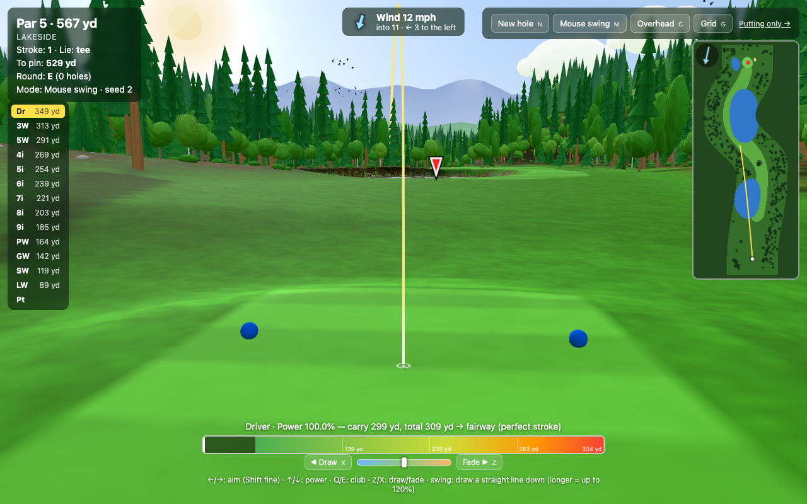

# Golf

A three.js golf game that generates a fresh random par 3, 4 or 5 hole every time, plus a putting-only mode.



## What it is

Every hole is procedurally generated from a seed: doglegs, fairways, rough, bunkers, ponds, rivers, cliffs and a deep surrounding forest. Holes come in different themes (parkland, lakes, canyon, links, forest), with things like carry lakes, island greens on par 3s and raised greens.

- Full ball-flight physics: drag, lift, backspin, wind (with a strong per-hole wind), bounces and roll that depend on the surface
- Draw and fade shot shaping
- 14 clubs with an auto caddie that picks a club, aim and power for you; the putter takes over on the green
- Balls bounce off trees, water and out-of-bounds cost a penalty stroke
- Three swing modes: **mouse swing** (draw a line down the screen; length sets power, a crooked stroke sends it offline), **cheat** (set power exactly and see the exact flight and roll before you hit), and a classic 3-press **meter**
- Minimap, overhead camera, optional putting grid, and birds and ducks for atmosphere
- A separate **putting-only** game at `/putting.html`
- The simulation is deterministic and runs bit-identically in Node and the browser, so every shot can be replayed exactly from its input log

## Controls

| Input | Action |
| --- | --- |
| ← / → | Aim (hold Shift for fine aim) |
| ↑ / ↓ | Power |
| Q / E or [ / ] | Change club |
| Hold Z / X | Fade / draw |
| Drag down the screen | Swing (mouse swing mode) |
| Space | Shoot / meter |
| Enter | Shoot (cheat mode) |
| Shift (while the ball is moving) | Fast-forward |
| N | New hole |
| M | Cycle swing mode |
| C | Overhead camera |
| G | Putting grid |
| H | Hide HUD |
| P | Pause |
| Mouse wheel | Zoom |

You can also click the terrain or minimap to aim, or click a club in the club list.

## Run locally

Requires Node.js. There's no build step; a tiny zero-dependency server serves the files directly.

```bash
npm install
npm start              # http://localhost:5173 (putting game at /putting.html)
npm test               # headless sim tests, no browser needed
npm run test:browser   # headless Chrome tests (Playwright)
```

There are also command-line tools for playing and inspecting holes without a browser (`npm run golf -- info --seed 7`, `npm run golf -- play --seed 7`) and for taking headless screenshots (`npm run shot`). See `AGENTS.md` for details.

## Tech stack

- Plain JavaScript ES modules, no bundler
- [three.js](https://threejs.org) for rendering, with terrain textures painted in Web Workers
- A pure, deterministic fixed-timestep simulation (custom math functions instead of `Math.sin`/`Math.exp` so results match across engines)
- Node's built-in test runner and Playwright for tests and screenshots
